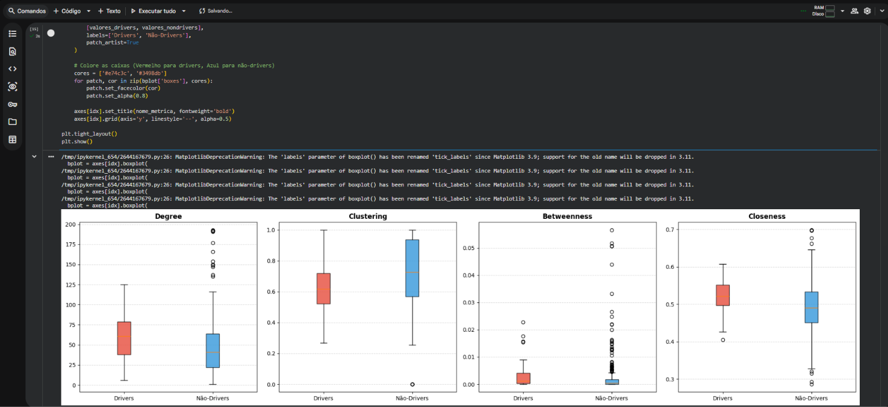

# Avaliação 03 — Redes de Proteínas e Cancro (Avaliação Ramos)

**Disciplina:** Tópicos em Tecnologia (TTEC) — IFSP Câmpus São Carlos  
**Tema:** Redes de Proteínas e Câncer: Ataque, Resiliência e Identificação de Genes Alvo  
**Docente:** Prof. Carlão Ramos  
**Discentes:** 
- Rafael Feltrim (SC3038734)
- Gustavo Gomes Contiero (SC3037754)

**Data de Submissão:** 06 de Outubro de 2026  
**Assunto do E-mail:** `TTEC AVALIAÇÃO RAMOS`  
**Destinatário:** `carlao2005@ifsp.edu.br`

---

## Links e Artefatos da Entrega

| Tipo | Descrição | Link / Arquivo |
|---|---|---|
| **Google Colab (Corrigido)** | Notebook interativo com correções na Atividade 2 | [Abrir no Google Colab](https://colab.research.google.com/drive/1x2aBTs8E9VkwFZe5G3KPsRLHwZuaUglS?usp=sharing) |
| **Google Colab (Original)** | Primeira submissão enviada | [Abrir no Google Colab](https://colab.research.google.com/drive/17V8UyQNgr7VjR0_K7Z3aHHT9vJrmECRP?usp=sharing) |
| **Relatório Técnico (PDF)** | Documento formal consolidado com saídas e discussão | [`TTEC_Avaliacao_Ramos_corrigido.pdf`](TTEC_Avaliacao_Ramos_corrigido.pdf) |
| **Notebook Local** | Cópia sincronizada do notebook do Colab | [`avaliacao_ramos.ipynb`](avaliacao_ramos.ipynb) |
| **Script Python** | Versão CLI independente para execução direta | [`avaliacao_ramos.py`](avaliacao_ramos.py) |
| **Dados de Entrada** | Rede e base de drivers canônicos | [`dados/`](dados/) |

---

## 1. Contextualização dos Dados

Para a modelagem computacional da via biológica de reparação de DNA (**DNA Repair**), utilizou-se um grafo não direcionado via **NetworkX**:

- **Rede de Interação (DNA Repair):** 332 nós (proteínas/genes) e 8.353 arestas (interações físicas e funcionais).
- **Genes Drivers Canônicos (`canonical_drivers.txt`):** 591 genes associados à carcinogênese e progressão tumorigênica.
- **Mapeamento Topológico:**
  - **43 genes drivers** presentes na rede.
  - **289 genes não-drivers**.

---

## 2. Atividade 1: Distribuição de Centralidades

Avaliação comparativa entre genes drivers e não-drivers através de diagramas de caixa (*Box Plots*) considerando quatro métricas clássicas de centralidade:

1. **Grau (Degree):** Quantidade direta de conexões incidentes no nó.
2. **Coeficiente de Agrupamento (Clustering Coefficient):** Densidade de conexões entre os vizinhos diretos de um nó.
3. **Intermediação (Betweenness Centrality):** Frequência em que o nó intercepta caminhos geodésicos mínimos.
4. **Proximidade (Closeness Centrality):** Inverso da soma das distâncias mínimas para todos os outros nós.



### Interpretação dos Resultados
- **Degree:** Os drivers possuem distribuição nitidamente deslocada para a direita (mediana > 60) contra mediana ~40 dos não-drivers, confirmando que atuam como **hubs**.
- **Betweenness:** Apenas os drivers alcançam valores elevados na cauda superior, funcionando como **gargalos estruturais (bottlenecks)** de sinalização.
- **Clustering:** Não-drivers têm mediana ligeiramente superior (0.72 vs 0.62), refletindo que drivers interligam módulos diferentes em vez de pertencerem a agregados hiperconectados locais.
- **Closeness:** Drivers possuem proximidade superior (~0.53 vs ~0.49), posicionando-se no centro informacional do grafo.

---

## 3. Atividade 2: Ataque Individual Sistemático e Impacto no LCC

Avaliação da resiliência da rede via remoção direcionada de cada um dos 43 genes drivers e medição do impacto na intermediação do **Maior Componente Conexo (LCC - Largest Connected Component)**:

$$\Delta B = \overline{B}_{\text{orig}} - \overline{B}_{\text{ataque}}$$


### Top 3 Alvos Críticos Identificados

| Classificação | Gene Driver | Impacto ($\Delta B$) | Função Biológica / Contexto Oncológico |
|:---:|:---:|:---:|---|
| **1º Lugar** | **TP53** | **-0.000030** | Supressor tumoral (*guardião do genoma*): ativa o reparo do DNA, a parada do ciclo celular ou a apoptose. |
| **2º Lugar** | **BRCA1** | **-0.000025** | Reparo de quebras de fita dupla via recombinação homóloga; mutações ligadas ao câncer de mama e ovário. |
| **3º Lugar** | **ATM** | **-0.000021** | Quinase sensora de quebras no DNA que dispara a resposta em cascata a danos (ativa TP53, BRCA1 e CHEK2). |

---

## 4. Como Executar Localmente

```bash
# Navegar até a pasta da entrega
cd "entregas/03_avaliacao_redes_proteinas"

# Executar o script Python
python avaliacao_ramos.py
```
